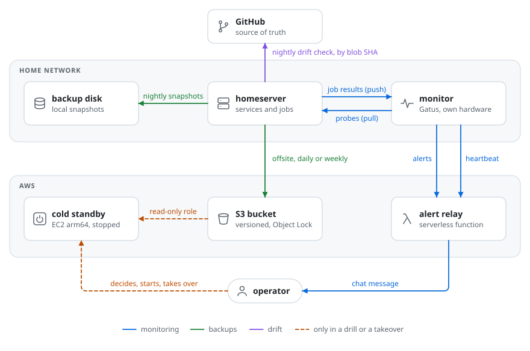
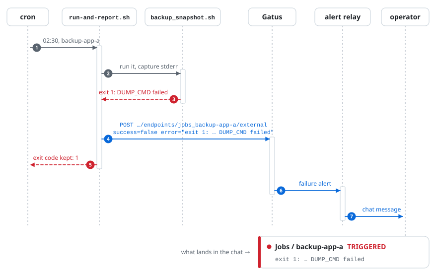

# homelab-blueprint

How I run a single-server homelab like a small production system. Every
scheduled job reports its outcome. Backups get restored every week. What is
installed is compared with git every night. And there is a rehearsed cold
standby in AWS for the day the box dies.

This is a **sanitized, runnable blueprint** of that setup. The real
configuration lives in a private repository. Hostnames, domains, services and
cloud identifiers here are placeholders (`example.com`, `*.example.internal`,
`192.0.2.0/24`, `app-a`, `blog`, `mailer`). The scripts are rewritten to be
small and generic. They keep the mechanisms that run at home, with a few
improvements made while extracting them.

| Pillar | The question it answers | Folder |
|---|---|---|
| **Monitoring** | Is it up? Did last night's job actually *work*? Is the monitor itself alive? | [`monitoring/`](monitoring/) |
| **Backups you can restore** | Can I really restore? Do the docs, the schedule and the offsite lists agree? | [`backups/`](backups/) |
| **Drift detection** | Is what runs on the server what is in git? | [`drift/`](drift/) |
| **Cold standby** | If the server dies, how do I come back, and what have I actually measured? | [`standby/`](standby/) |

## Architecture

<picture>
  <source media="(prefers-color-scheme: dark)" srcset="docs/diagrams/architecture-dark.svg">
  
</picture>

Design choices that run through all four pillars:

- **The monitor is not the thing it monitors.** Gatus runs on separate
  hardware. Something *outside the house* watches the monitor.
- **Silence is a failure.** Jobs push a result on success *and* on failure,
  and every push endpoint has a heartbeat. A job that stops running goes red
  on its own.
- **Untested is not green.** A restore check that could not run reports
  `unknown`, and `unknown` alerts like a failure.
- **"Could not check" ≠ "found a problem".** Each checker has a separate exit
  code for each case, so a broken token never reads like drift.
- **Humans make the irreversible calls.** The standby never takes over by
  itself. The takeover refuses to run without an explicit "the primary is
  down" flag. The drill is hard-wired to dry-run.

## How a failure surfaces

The common path: a nightly backup fails at 02:30.

<picture>
  <source media="(prefers-color-scheme: dark)" srcset="docs/diagrams/failure-path-dark.svg">
  
</picture>

And everything else that can go wrong, with what catches it:

| What breaks | What notices | What you see |
|---|---|---|
| A job exits non-zero | `run-and-report.sh` pushes `success=false` with the stderr tail | That job's endpoint goes red the same night, with the reason |
| A job **never runs** (box down at 02:30, cron line deleted, timer disabled) | Nothing is pushed | The heartbeat expires (30 h for daily jobs) → red, "no update received" |
| The job reports to a key Gatus does not know | `check_gatus_config.py` in CI; the reporter logs 404 as its own error | CI fails before deploy instead of a job that *looks* monitored |
| A backup "succeeds" but cannot be restored | The weekly restore test | `restore-test` goes red, naming the family and the failed assertion |
| The schedule, the offsite lists, the restore test and the DR docs disagree | `check_backup_consistency.py` in CI | CI fails with one line per mismatch |
| Someone hot-fixes code on the server | The nightly drift check | `config-drift` goes red, naming the file |
| The monitor, the home internet or the power dies | The relay's own scheduled check of the monitor's signed heartbeat | A warning, then a critical alert, within minutes; exactly one recovery |
| The server dies for good | Gatus probes, then a person | [`standby/runbook.md`](standby/runbook.md) |

## Try it

Requirements: bash, Python 3.10+, git, sqlite3. PyYAML is needed for the
Gatus lint and its tests, and those tests are skipped if it is missing. No
root or AWS account is needed, and Docker only for `make test-docker`.

```bash
make test         # 57 unit tests: wrappers, snapshot script, restore test, drift, coherence, Gatus lint
make check        # lint the example Gatus config and check the example backup sources agree
make demo         # backup -> restore test (green) -> silent corruption -> restore test (red)
make test-docker  # the mailer family restored into a real Postgres (needs Docker; CI runs it)
```

The three tests that need Docker are skipped by `make test` when it is not
there. CI runs them in a job of their own that fails instead of skipping.

`make demo` builds two sample apps in a temp directory, snapshots them, and
restores them. Then it silently appends one byte to a file inside the newest
backup, the kind of damage a dying disk or a buggy job does, and shows the
weekly test catching it:



The last line goes to stderr. It is exactly what `run-and-report.sh` would
send to Gatus as the alert text.

## Layout

```text
monitoring/
  gatus/config.example.yaml   probes, push endpoints with heartbeats, alerting via a relay
  jobs/run-and-report.sh      wrap any command; report its outcome; keep its exit code
  jobs/report-job.sh          the push itself (per-endpoint tokens, 404 ≠ unreachable)
  watchdog/send-heartbeat.sh  HMAC-signed heartbeat for the dead man's switch
  check_gatus_config.py       lint for what Gatus accepts silently
backups/
  backup_snapshot.sh          nightly snapshot: consistent SQLite copy, SHA256SUMS, atomic publish, rotate last
  restore_test.py             weekly restore into a throwaway scratch; pass / fail / unknown
  check_backup_consistency.py do the schedule, offsite lists, restore test and DR inventory agree?
  systemd/                    hardened restore-test unit + weekly timer
  examples/                   cron file, offsite lists, DR inventory
drift/
  check_drift.py              installed files vs the git tree, by blob SHA, without cloning
  drift-manifest.example.json
standby/
  README.md                   design of the AWS cold standby, and what is measured vs not
  runbook.md                  detect → decide → start → take over → fail back; quarterly drill
  provision-standby.sh        rebuild the standby from nothing (read-only role, IMDSv2, encrypted EBS)
  standby-userdata.sh         cloud-init: runtimes, rehearsal block, pre-staged bundles
  takeover.sh                 guarded takeover, run on the standby
  takeover-drill.sh           start → dry-run takeover → always stop; evidence log
  iam/                        read-only standby role, no-delete uploader
docs/
  decisions.md                the design decisions, ADR-style
  lessons.md                  the failures that shaped each piece
  diagrams/render.py          draws every diagram here, light and dark (make diagrams)
tests/                        unittest suite (stdlib only, plus PyYAML for one module)
  test_restore_docker.py      the mailer family against a real Postgres
```

## What is intentionally left out

- **Every real identifier.** That covers hostnames, domains, IPs, VPN names,
  cloud account and resource IDs, bucket names, and chat channels.
- **The service inventory.** The real setup runs a few dozen services and
  scheduled jobs. Here they are `app-a`, `app-b`, `blog`, `mailer` and
  `scheduler`.
- **The application-specific restore checks.** The real restore test has a
  check per app. Examples: load a database dump into a fresh container, sample
  a file-sync service's index and verify those files' checksums in the data
  snapshot, start a service on the restored copy and probe its health route,
  decrypt an encrypted export in memory and compare it to its manifest. Three
  representative checks are kept here.
- **The alert relay's source.** It is a small serverless function. Its
  behaviour is described in [`monitoring/README.md`](monitoring/README.md):
  authenticated events, de-duplication, rate limiting, and the heartbeat
  watchdog.
- **Firewall, intrusion-prevention, VPN ACL and tunnel configuration.** These
  are described, not published.
- **Secrets handling details** beyond the pattern: per-endpoint tokens in
  0600 files outside git, an encrypted secrets bundle, and a recovery
  passphrase kept *outside* the system it recovers.

## Related

- Article: [Un standby frío en AWS para mi servidor casero: qué medí y qué falta
  probar](https://builder.aws.com/content/3KsTKSPIcI2vPjk1pr5gAQPPdTE/un-standby-frio-en-aws-para-mi-servidor-casero-que-medi-y-que-falta-probar)
  (AWS Builder Center, in Spanish). It covers the design and the drill
  measurements behind [`standby/`](standby/).

## License

[MIT](LICENSE).
