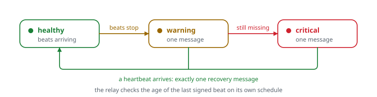

# Monitoring

Three layers, each one covering a blind spot of the one before:

| Layer | Answers | Mechanism |
|---|---|---|
| **Probes** (pull) | Is the service up and *healthy*? | Gatus checks HTTP, TCP and DNS every 2 min from the monitor |
| **Job heartbeats** (push) | Did the scheduled job run, and did it succeed? | Each job pushes its result to a Gatus external endpoint that has a heartbeat |
| **Watchdog** (external) | Is the monitor itself alive? | The monitor signs a heartbeat to a relay outside the house, and the relay alerts when the heartbeat stops |

Gatus runs on a small always-on board on the LAN, **not** on the server it
watches. Like every private dashboard here, it is reachable only over the
VPN. Alerts go out through one `custom` provider: a small serverless relay
that forwards them to a private chat channel.

## Probes: assert health, not just liveness

[`gatus/config.example.yaml`](gatus/config.example.yaml) shows the patterns
worth stealing:

- **Hit a route that loads state.** Probe `/api/health`, which reads the job
  store, rather than `/`. Static HTML happily answers 200 while the data file
  underneath it is corrupt.
- **Make security properties into checks.** An anonymous request to an
  admin route must be refused, so the probe asserts
  `[STATUS] == any(401, 403)`. If a deploy ever drops the auth middleware,
  the check goes red even though the site works fine.
- **Make "a human must act" visible.** A review-queue endpoint always answers
  200 and puts the count in the body. The probe asserts `needsReview == 0`.
- **Check credentials by using them.** An OAuth status route performs a real
  token refresh. The probe runs every 30 min rather than every 2 min, because
  each probe costs the provider a token.
- **Separate DNS from connectivity.** The "internet" probe goes to an IP
  address, so a DNS failure and an outage show up as two different red lights.
- Certificate expiry is checked on every TLS probe (`> 168h`), and domain
  registration expiry on the apex (`> 720h`).

## Job heartbeats: silence is a failure

The failures that hurt were all of the kind a port check cannot see. The
dashboard was green while a weekly ingest never ran, a token expired, or a
publisher logged a warning and moved on.

```text
cron / systemd ──► run-and-report.sh <key> <command…>
                     │  runs the command; stdout untouched; stderr captured and replayed
                     │  exit code preserved
                     ▼
                   report-job.sh <key> ok|fail "<stderr tail>" <seconds>
                     │  POST /api/v1/endpoints/jobs_<key>/external?success=…&error=…&duration=…
                     │  Authorization: Bearer <per-endpoint token>
                     ▼
                   Gatus external endpoint `Jobs / <key>`  (heartbeat: 30h daily, 192h weekly)
```

The details that matter:

- **Push always.** A reporter that only speaks on failure can't tell "fine"
  from "never ran". With a push on every run, the expired **heartbeat** is the
  alert for a job that didn't run.
- **Heartbeat = cadence + one run of grace, in hours.** Gatus uses Go
  durations, which have no days: `8d` stops the service from starting. The
  lint catches it.
- **Weekly jobs alert at threshold 1.** With the default 3-failures/2-successes,
  a weekly job would page on its third bad week.
- **One token per endpoint.** A leaked token can fake only that one job.
  Tokens live in a 0600 file outside git, never in the YAML.
- **A 404 is not "monitor down".** Gatus keys endpoints as `<group>_<name>`.
  Push to the wrong key and you get a 404, which a naive script logs as
  "unreachable" while the endpoint waits forever. The reporter logs 404,
  401/403 and unreachable as three different errors.
  [`check_gatus_config.py`](check_gatus_config.py) fails CI when a cron line
  or unit reports to a key that has no endpoint.
- **The reporter never breaks the job.** It always exits 0, and the wrapper
  exits with the job's own code.
- **Root jobs report as an unprivileged user.** `REPORT_AS=ops` runs the
  reporter through `sudo -u ops`. The tokens stay owned by `ops`, and root
  never executes a file `ops` could have edited.

Wiring a job takes one line (see [`jobs/crontab.example`](jobs/crontab.example)):

```cron
10 6 * * * ops run-and-report.sh config-drift check_drift.py >> /var/log/homelab/drift.log 2>&1
```

## Watchdog: who watches the watcher

If the monitor, the home internet or the power goes, nothing inside the house
can say so: the thing that would alert is the thing that died. So
[`watchdog/send-heartbeat.sh`](watchdog/send-heartbeat.sh) sends a signed
heartbeat from the monitor every few minutes to the relay outside, and the
relay checks the age of the last heartbeat on its own schedule. It is a dead
man's switch, and a whole-house outage surfaces within minutes:

<picture>
  <source media="(prefers-color-scheme: dark)" srcset="../docs/diagrams/watchdog-dark.svg">
  
</picture>

- The relay sends exactly one message per state change. It stores the new
  state *only after* the chat webhook accepts the message, so a failed
  delivery is retried on the next tick rather than lost.
- The signature is `HMAC-SHA256(secret, "<unix ts>.<sha256(body)>")` with a
  short freshness window, to stop replays. The heartbeat route rejects the
  static bearer token Gatus uses, so a leaked Gatus token cannot keep a dead
  monitor "alive".
- The relay also validates event schemas, caps body size, rate-limits per
  source, and de-duplicates events by id.
- It was tested on purpose. In an agreed window, the sending timer was
  stopped long enough to cross both thresholds. Warning and critical each
  fired on the first scheduled check past their threshold, followed by
  exactly one recovery.

## Server health report

One more push, from the monitor this time. Twice a day it pulls a facts-only
JSON report from the server over SSH, judges it against fixed thresholds and
pushes the verdict to `Infrastructure / server-health`. The report covers
backup age and retention counts, disk use, failed units, expected services
and containers, and SMART. The SSH key is locked to one forced command, and
that command is the only thing the account may run with sudo. The monitor
cannot run anything else on the server.
