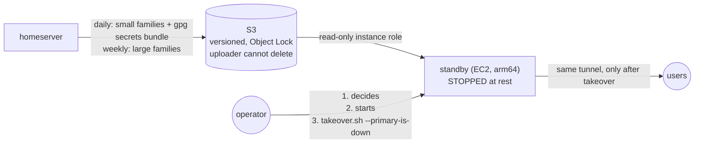

# Cold standby in AWS

My home server is a single machine. A backup disk in the same chassis covers
a deleted file. It does not cover losing the chassis to a dead PSU, a power
surge, theft or a flood. This is the design for that day. It has two parts:
copies outside the house, and a pre-built machine in AWS that stays **off**
until a person decides to use it.

> Written up for a general audience in [Un standby frío en AWS para mi servidor
> casero: qué medí y qué falta probar](https://builder.aws.com/content/3KsTKSPIcI2vPjk1pr5gAQPPdTE/un-standby-frio-en-aws-para-mi-servidor-casero-que-medi-y-que-falta-probar)
> (AWS Builder Center, Spanish).

## Shape

| Piece | Choice | Why |
|---|---|---|
| Offsite | S3, versioning + Object Lock, server-side encryption | A compromised or buggy server can add versions but cannot destroy history |
| Uploader | Put and read back; explicit **Deny** on delete, retention and bucket-policy changes ([`iam/backup-uploader.json`](iam/backup-uploader.json)) | Least privilege on the one credential that lives at home |
| Compute | One small arm64 instance, 60 GB encrypted gp3, **stopped at rest** | Stopped, it costs only its volume (the auto-assigned public IPv4 is released on stop) |
| Standby access to data | Instance role, **read-only** on the bucket ([`iam/standby-read-only.json`](iam/standby-read-only.json)); no access key on the box | The standby restores *from* the backups and can never modify them |
| Network | No service port open. SSH from the operator's /32 at most; everything else over the VPN; IMDSv2 required | Nothing to attack while it is running for a drill |
| Pre-staging | Runtimes installed, builds staged, units installed and **disabled**, bundles synced at bootstrap | A takeover pulls fresh data rather than building software |
| Secrets | One gpg bundle. The passphrase, the standby's SSH key and the cloud, VPN and DNS admin logins sit in a password manager that does **not** depend on the homelab | Recovery must not need the system being recovered |

## Why cold, and why a human decides

- **Split brain is the real risk.** The standby runs the same tunnel and holds
  the same API credentials as the primary. If both are up, the tunnel splits
  live traffic between two hosts, a bot answers every message twice, and a
  scheduler publishes the same post twice. An automatic failover would fire on
  a home-internet blip, which is exactly when the primary is still alive.
- **The target is hours, not seconds.** For a homelab, a few hours of
  downtime costs less than a double-publish incident, and much less than
  building reliable fencing.
- **Cost.** Stopped, the standby is a single EBS volume. Running costs several
  times that, and only during drills or a real takeover.

## Safety rails, in code

1. [`takeover.sh`](takeover.sh) **refuses** a real run without
   `--primary-is-down`. The flag is the operator's signature that the primary
   is really down and will stay down.
2. **Due jobs are held.** A scheduler started from a snapshot would publish
   everything that was pending when the snapshot was taken, including what the
   primary has published since. Every job already due is set to
   `held-failover`, to be released by hand.
3. **Rehearsal block.** Until a real takeover removes it, `/etc/hosts` on the
   standby sends the external APIs the services call to `0.0.0.0`. A rehearsal
   cannot post, send or charge anything.
4. **Dry run means no secrets.** `--dry-run` decrypts nothing, starts nothing,
   and strips every live API key from the staged job store.
5. [`takeover-drill.sh`](takeover-drill.sh) is **hard-wired to dry-run**. The
   remote command is a constant, and flags that look like a real takeover are
   refused. It also refuses to start if the standby is not stopped, since that
   could be a real takeover in progress that its trap would then stop. It
   **always** stops the instance (EXIT/INT/TERM trap) and puts the resting
   instance type back. If it cannot confirm the instance is stopped, it exits
   with a distinct code (3), because the standby is now costing money.
6. **Capacity fallback.** The first automated drill failed with
   `InsufficientInstanceCapacity`. Start now retries, then switches to other
   arm64 types while stopped.

## RPO and RTO

**RPO** (how old the newest offsite copy can be) is ≤ 24 h for the daily
families and the secrets bundle, and ≤ 7 days for the weekly ones. That holds
only if the jobs succeed. The job heartbeats in [`../monitoring/`](../monitoring/)
make that condition observable instead of assumed.

**Measured**, on a guarded dry-run drill from a stopped instance:

| Step | Time |
|---|---|
| start request → `running` | 9 s |
| `running` → SSH answers | 17 s |
| `takeover.sh --dry-run`: pull the newest bundles from S3 and stage the data (no secrets decrypted, no service started) | 240 s |
| **start request → data ready** | **266 s** |
| stop → independently confirmed `stopped` | 24 s |
| whole drill | 295 s |

An earlier drill reached "data ready" in 204 s, so neither number is a promise.

**266 s is data preparation, not a service RTO.** It covers starting the
instance and staging the data. Stopping the primary, moving the tunnel or
DNS, and starting the services come on top of it.

## What comes back, and what doesn't

The takeover brings back the publishing and automation services and a
read-only dashboard. The public self-hosted services (file sync, password
vault, task app, mailer) are **not** on the standby. They stay down until a
host is rebuilt from the bundles and from the compose files and units in git.

A **read-only personal tier** for the standby is designed:
a throwaway copy of the password vault, the task list and the agents' notes,
all reachable over the VPN only, behind an identity check. Two rules shape it:

- **Read-only on purpose.** Anything written on the standby would fork from
  the primary when it returns, so the services refuse writes rather than accept
  and later lose them.
- **Different loopback ports from the tunnel's ingress rules.** The standby
  runs the same tunnel config as the primary. If the read-only copies listened
  on the ports that config routes public hostnames to, the internet could
  reach them.

## Files

| File | What |
|---|---|
| [`provision-standby.sh`](provision-standby.sh) | Rebuilds the security group, read-only role, key pair and instance from nothing |
| [`standby-userdata.sh`](standby-userdata.sh) | Cloud-init: runtimes, VPN and tunnel clients (unauthenticated), rehearsal block, pre-staged bundles |
| [`takeover.sh`](takeover.sh) | The guarded takeover, run on the standby |
| [`takeover-drill.sh`](takeover-drill.sh) | The drill, run from a laptop: start → dry-run takeover → always stop → evidence |
| [`iam/`](iam/) | Read-only standby policy and no-delete uploader policy |
| [`runbook.md`](runbook.md) | What a person does, in order, on the bad day, and every quarter |
